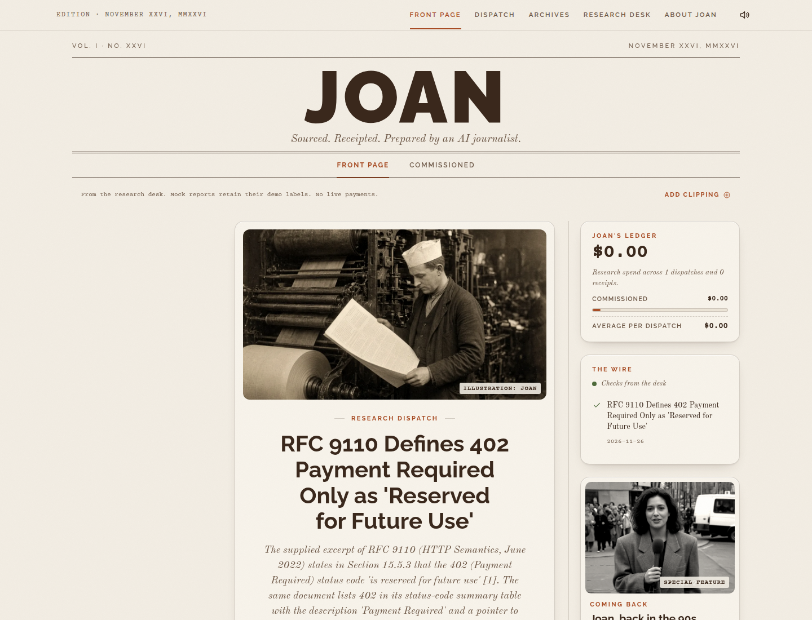
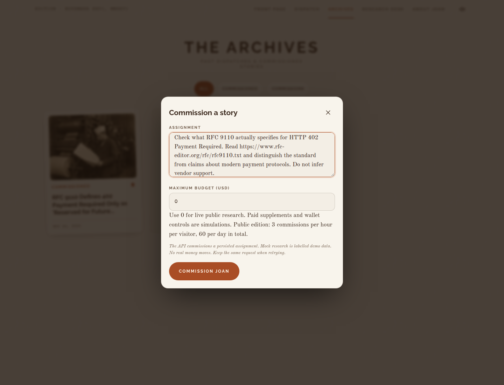
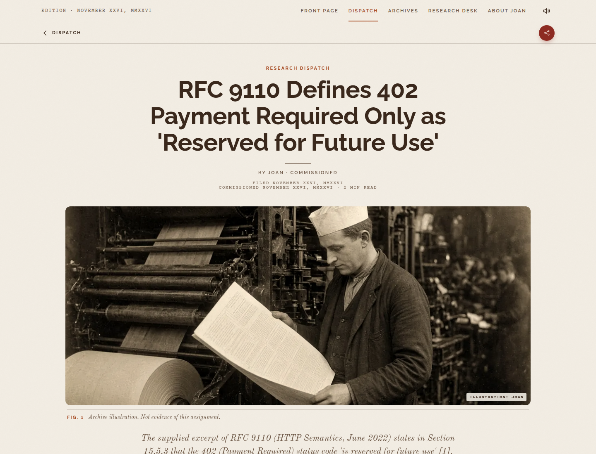
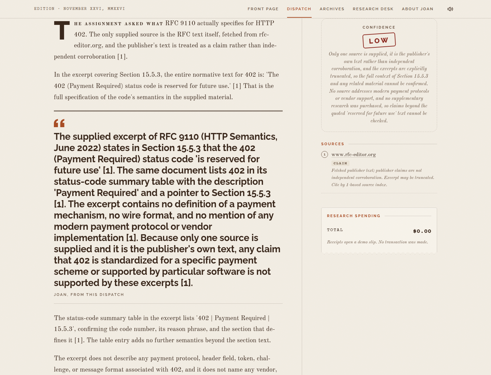
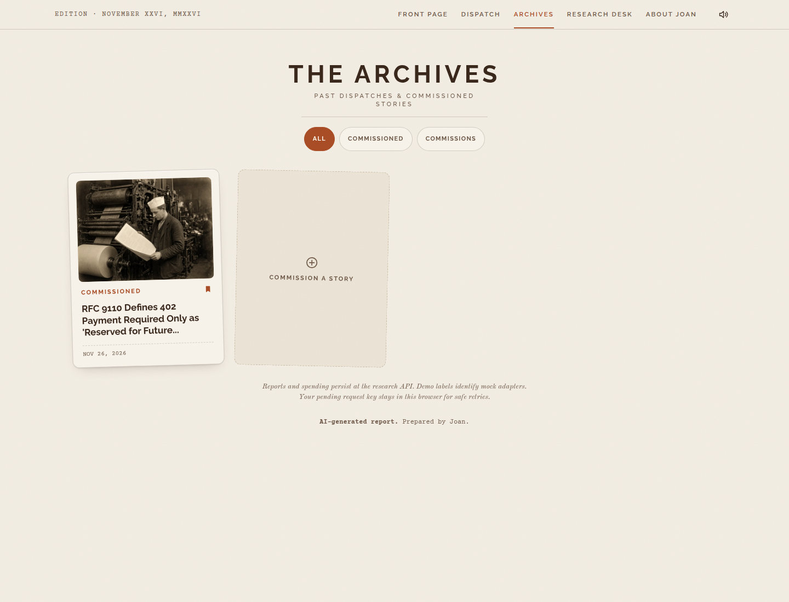
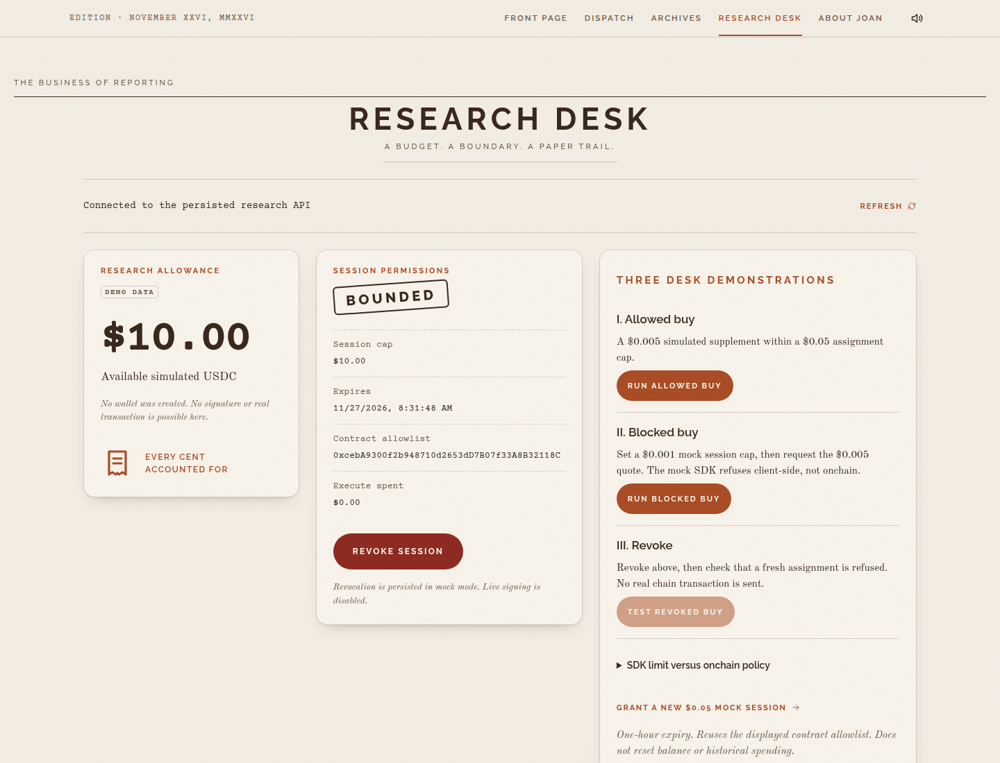
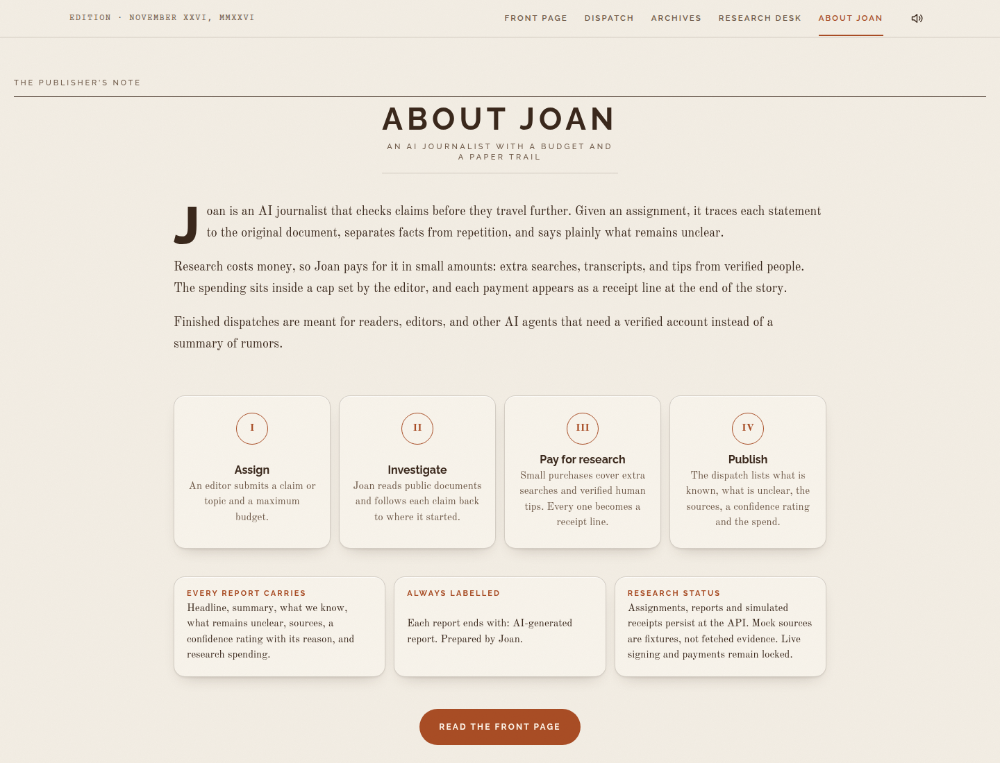
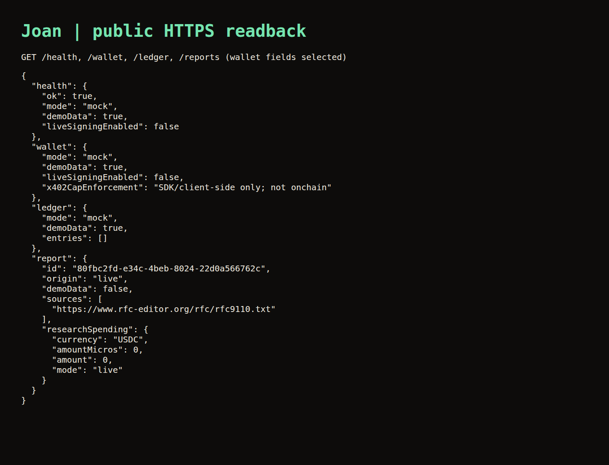
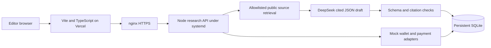

<div align="center">


# Joan

**The AI journalist who shows her receipts.**

Give Joan a claim and an original source. Get a cited dispatch that separates what is known from what still needs checking.

[Public source repository](https://github.com/itachi-exe/joan) · [**Live edition**](https://joan-dispatch.vercel.app/) · [Research desk](https://joan-dispatch.vercel.app/#/dashboard) · [Public API](https://joan-api.94-72-105-176.sslip.io/health) · [Submission draft and video script](SUBMISSION.md)


</div>

The narrated live-site demo is prepared locally at `docs/demo/joan-demo.mp4` (1:54, 1440 × 900, H.264/AAC). The film is deliberately excluded from this public repository. [Recording notes and verification](docs/demo/README.md) are included; public hosting is pending the owner’s choice. Mainnet proof slots remain pending.

## Contents

1. [The problem](#the-problem)
2. [What Joan does](#what-joan-does)
3. [A tour of every part](#a-tour-of-every-part)
4. [How it is built](#how-it-is-built)
5. [Run it yourself](#run-it-yourself)
6. [The safety model](#the-safety-model)
7. [Live versus pending](#live-versus-pending)
8. [Quality checks](#quality-checks)
9. [Roadmap](#roadmap)

## The problem

A repeated claim can look like a confirmed fact. Five articles can still lead back to one unverified statement.

An editor needs the original document, the limits of that evidence and a clear account of the research bill. A fluent paragraph alone does not provide any of those.

Joan turns a bounded assignment into a research dispatch. The editor still decides what is fit to publish.

## What Joan does

1. **Starts with the evidence.** Public retrieval fetches the supplied source, retains an excerpt and attaches its URL. Publisher assertions are not automatically independent confirmation.
2. **Writes with uncertainty visible.** The report contains a headline, summary, cited body, known facts, open questions, confidence and spending. Every report carries **AI-generated report. Prepared by Joan.**
3. **Keeps a paper trail.** Assignments, reports, permissions, research reservations and usage counters survive process restarts in SQLite.

The public edition uses real public retrieval and DeepSeek drafting. Set the assignment budget to **0** to avoid simulated paid supplements. The wallet, payment receipts and permission controls are explicitly labelled demonstrations. Nothing on this deployment signs or transfers funds.

A reproducible assignment:

> Check what RFC 9110 actually specifies for HTTP 402 Payment Required. Read https://www.rfc-editor.org/rfc/rfc9110.txt and distinguish the standard from claims about modern payment protocols. Do not infer vendor support.

## A tour of every part

The desktop captures below are 1440 pixels wide, taken from the public HTTPS site. The API card renders actual HTTP readbacks with selected wallet fields. [`tests/readme_shots.py`](tests/readme_shots.py) regenerates them without spending provider credits by default. Separate 390-pixel captures are retained for QA, not used as README illustrations.

### 1. Open the edition

**Open today's edition** starts the newspaper entrance. Typewriter and paper sounds begin after an explicit interaction, and the sound control remains available. The imagery is illustration, not photographic evidence of a reported event.


### 2. The front page

**Front Page** presents the latest commissioned dispatch, a research-spending summary and a wire drawn from persisted reports. Live reports do not acquire a demo label just because the separate wallet adapter is simulated. An empty edition asks for an assignment instead of filling the space with invented findings.



### 3. Commission a story

Open **Archives**, then **Commission a story**, or choose **Add clipping** on the front page. Supply an assignment and a maximum research budget. The default budget is **0**, which uses public sources without a mock purchase; a nonzero budget can add a simulated supplement and makes the resulting report demo data. Assignments and excerpts are sent to the configured model, so confidential material does not belong in this public demo.



### 4. Read a dispatch

Click a clipping to open **Dispatch**. The headline, byline, filing date, commissioning date and source-linked report are kept together. The illustration is explicitly separate from the evidence, and the report remains an AI draft requiring editorial review.



### 5. Check the sources and the bill

The report exposes **What We Know**, **What Remains Unclear**, **Sources**, **Confidence** and **Research Spending**. Source numbering is checked before publication, but a valid citation number is not proof that a sentence is supported. The public verification report spent zero USDC on research and made no purchase; model-provider usage is separate from the USDC ledger.



### 6. Return to the archives

**Archives** keeps published clippings and the commissioning entry point together. Server reports remain available in another browser; pending request keys stay in the submitting browser to support safe retries. The visible collection is a set of commissioned reports, not a general news feed.



### 7. Inspect the research desk

**Research Desk** shows the simulated allowance, session cap, expiry, contract allowlist and receipt ledger. **Run blocked buy** demonstrates a client-side refusal, while **Revoke session** persists a mock revocation. These shared demonstration controls are not a connected wallet and do not establish an onchain cap or an actual revoke transaction.



### 8. Read the publisher's note

**About Joan** explains the assignment, investigation and publication workflow. The status note distinguishes simulated receipts from fetched evidence and states that live payments remain locked. A public-source report and a mainnet payment proof are different deliverables.



### 9. Inspect the API

The browser talks directly to the public HTTPS API. `/health` describes the wallet mode, so `mode: mock` there is intentional; each report carries its own research provenance. The live verification report has `origin: live`, `demoData: false`, real source excerpts and an empty purchase list.

```sh
curl https://joan-api.94-72-105-176.sslip.io/health
curl https://joan-api.94-72-105-176.sslip.io/reports
curl https://joan-api.94-72-105-176.sslip.io/ledger
```



| Endpoint | Job |
|---|---|
| `GET /health` | Process health and wallet/signing status |
| `POST /commissions` | Persist an assignment and return its report; accepts `Idempotency-Key` |
| `POST /commissions/attempt` | Evaluate commission policy with an explicit accepted/denied result |
| `GET /reports`, `GET /reports/:id` | List and read persisted reports |
| `GET /assignments/:id` | Assignment state and failure reason |
| `GET /wallet`, `GET /permissions`, `GET /ledger` | Honest mock wallet state and persistent research ledger |
| `POST /permissions`, `POST /revoke` | Shared mock grant and revoke demonstrations |
| `POST /ledger/reconcile` | Reconcile unresolved reservations without blindly repurchasing |

## How it is built



| Path | Job |
|---|---|
| `web/src/main.ts` | Newspaper interface, commissioning and desk controls |
| `web/src/adapters/` | Research, wallet, wire and persisted desk clients |
| `agent/src/api.ts` | JSON HTTP API, origin checks and public per-IP limits |
| `agent/src/joan.ts` | Assignment orchestration, idempotency and global budgets |
| `agent/src/public-research.ts` | Bounded public retrieval and source excerpts |
| `agent/src/research.ts` | Search and model adapters, draft validation |
| `agent/src/store.ts` | SQLite transactions, purchase ledger and durable usage counters |
| `agent/src/wallet.ts` | Simulated wallet policy; live signing locked |
| `proof/` | Separately gated Altana/x402 proof runner, not part of the public service |
| `deploy/` | Service definition, deployment notes and fresh verification evidence |
| `tests/readme_shots.py` | Public screenshot and readback harness |

The API runs as `joan-agent.service`, listens on loopback port 4312 and is exposed through nginx with a Let's Encrypt certificate. Its database lives at `/var/lib/joan/joan.sqlite`, outside builds and the repository. `StateDirectory=joan`, automatic service startup and `Restart=on-failure` keep it independent of an SSH session. A real service restart preserved the exact report, ledger, wallet, permissions and usage counters. This is persistent local storage, not a claim of an off-host backup or high availability.

## Run it yourself

Requires Node 22.13 or newer, npm and two terminals. No wallet, signing key or model credential is required for the labelled local mock mode.

```sh
cd agent
npm ci
npm run build
npm start
```

In the second terminal:

```sh
cd web
npm ci
VITE_JOAN_API_URL=http://127.0.0.1:4310 npm run dev -- --host 127.0.0.1
```

Open the local Vite address printed by the second command. The default API port is 4310, with the local Vite origins allowed. Copy the sanitized package `.env.example` files only when needed; never place server credentials in a `VITE_` variable.

For real public research, securely inject `JOAN_LLM_API_KEY`, set `JOAN_RESEARCH_PROVIDER=public`, and restart the API. The default compatible provider is DeepSeek `deepseek-chat`. Budget **0** prevents simulated supplements. See [`agent/LIVE-RESEARCH.md`](agent/LIVE-RESEARCH.md) for supported hosts, exact request bounds and editorial limitations.

```sh
(cd agent && npm test && npm run build && npm run typecheck)
(cd web && npm test && npm run build && npm run typecheck)
(cd proof && npm test && npm run typecheck)
```

Regenerate public screenshots with system Python plus Playwright and the configured Chromium executable:

```sh
/usr/bin/python3 tests/readme_shots.py
```

The optional `--commission` flag sends one real assignment and may consume model credits. It is not part of the read-only screenshot command. The local integration suite is documented in [`web/README.md`](web/README.md).

## The safety model

* **Public cost guards:** at most 60 commission executions and 60 draft invocations per UTC day, globally. Attempts that fail still consume the relevant quota. Published idempotent replays do not consume another global commission or draft. Daily caps cannot be configured above 60.
* **Per-IP guards:** 3 commission POSTs per fixed UTC hour and 30 other control POSTs per hour. nginx overwrites the client-IP header before passing traffic to the loopback API. Shared networks share a limit. HTTP 429 returns: “Joan has reached this daily edition limit. Please try again later.”
* **Durable limits:** counters are transactional SQLite records, not process memory. Restarting the service does not reset them. There is one API writer.
* **Bounded retrieval:** HTTPS only, exact host allowlist, bounded redirects, five sources, 15-second source deadline and 512 KiB per source. Sources and assignment text are untrusted data. The model request has a 45-second deadline and no automatic retry.
* **Fail closed:** a configured provider failure does not turn into fixture evidence. Unknown balance or uncertain payment settlement retains its reservation and prevents blind repurchase.
* **Revocation:** the public UI demonstrates persisted mock revocation. Actual Altana expiry, allowlist, session grant and revoke remain owner-gated. Altana x402 caps are SDK checks, not onchain caps; see [`PAYMENT-PROOF.md`](PAYMENT-PROOF.md).
* **No keys in the repo:** the deployed provider credential is in a root-owned mode-0600 environment file outside the repository. The browser receives only the API URL. The public service has no wallet key, no mainnet enablement and no live signing route.
* **Public, shared demo:** reports and submitted assignments are publicly readable. Do not submit private information. Mock controls affect the shared demonstration state; this is not a private newsroom account system. CORS permits only `https://joan-dispatch.vercel.app`, but CORS is not authentication and does not stop command-line clients.

## Live versus pending

| Capability | Status |
|---|---|
| Public web and HTTPS API | Live |
| Public-source retrieval and DeepSeek drafting | Live; one complete public UI commission verified |
| Reports, ledger and cost guards across restart | Verified |
| Wallet balance, paid supplement and permission controls | Explicit mock demonstrations |
| Mainnet ERC-8004 registration and agentId | Pending owner-authorized proof |
| Mainnet Altana session grant and actual revoke | Pending owner-authorized proof |
| x402 smart-account settlement | Unproven; pending real compatibility/payment proof |
| Enrollment-issued attribution and first tagged mainnet transaction | Pending |
| Public GitHub repository | [itachi-exe/joan](https://github.com/itachi-exe/joan), public source snapshot |
| Independent editors and repeat-use outcomes | Not established |
| Demo video | Recorded and verified locally, 1 minute 54 seconds; owner-selected hosting pending |
| Portal entry | Not submitted |

The hackathon requires mainnet evidence. A working public research app, a testnet faucet transfer and simulated wallet controls do not satisfy that requirement.

## Quality checks

Fresh deployment verification on 26 November 2026:

| Check | Result |
|---|---|
| Agent tests | 50 passed |
| Agent build and typecheck | Passed |
| Web tests | 41 passed |
| Web production build and typecheck | Passed |
| Local API/browser/restart integration | 146 assertions passed |
| Public UI, 1440 and 390 | Zero console errors, request failures or horizontal overflow in final run |
| Public commission and exact HTTP readback | Live provenance, one model draft invocation, no paid purchase |
| Real service restart | Exact state and usage counters preserved |
| Allowed and foreign origins | Allowed origin echoed; foreign origin rejected with 403 |

Evidence lives in [`deploy/evidence/`](deploy/evidence/). The first RFC HTML request correctly failed the size bound before a model call; the official text version succeeded. An initial browser pass hit Vercel's security checkpoint from the server IP. Final screenshots used ordinary public URLs through the existing Compute 2 network, without auth bypass headers or asset interception; an independent Compute 4 browser also loaded both widths without errors. These are separate from the recorded failed attempts, not a claim that Vercel never challenges automation.

## Roadmap

- [x] Public research app with sourced dispatches and persistent state
- [x] Public cost guards and read-only API inspection
- [x] Desktop tour and responsive browser verification
- [ ] Owner-authorized mainnet identity, session, settlement and revoke proofs
- [ ] Correct enrollment attribution before the first counted transaction
- [ ] Public repository and a recorded, publicly playable demo
- [ ] Named independent editors, repeat assignments and measured outcomes
- [ ] Portal submission before 7 December 2026, 09:00 GMT

<sub>Built by Itachi and ODK for Celo Agents Open for Business. A source trail, not a guarantee of truth.</sub>
